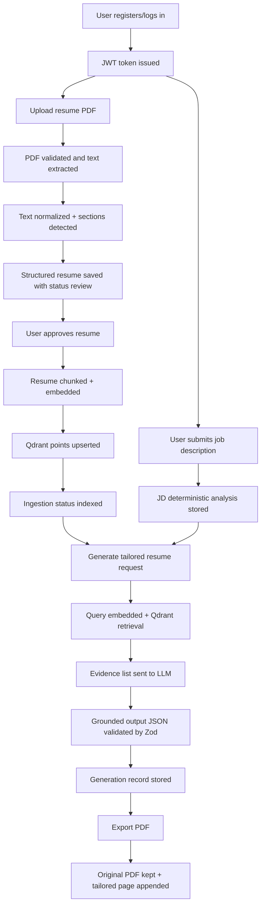
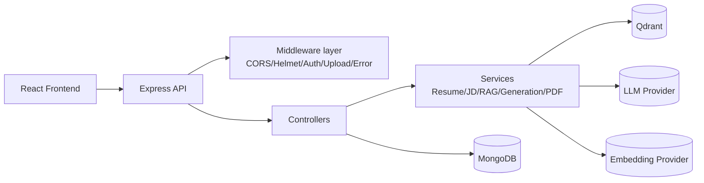
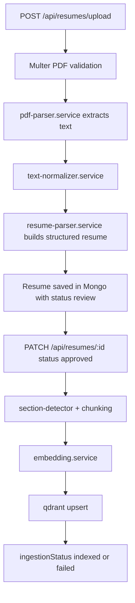
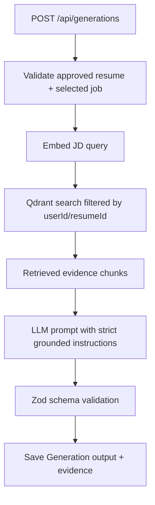
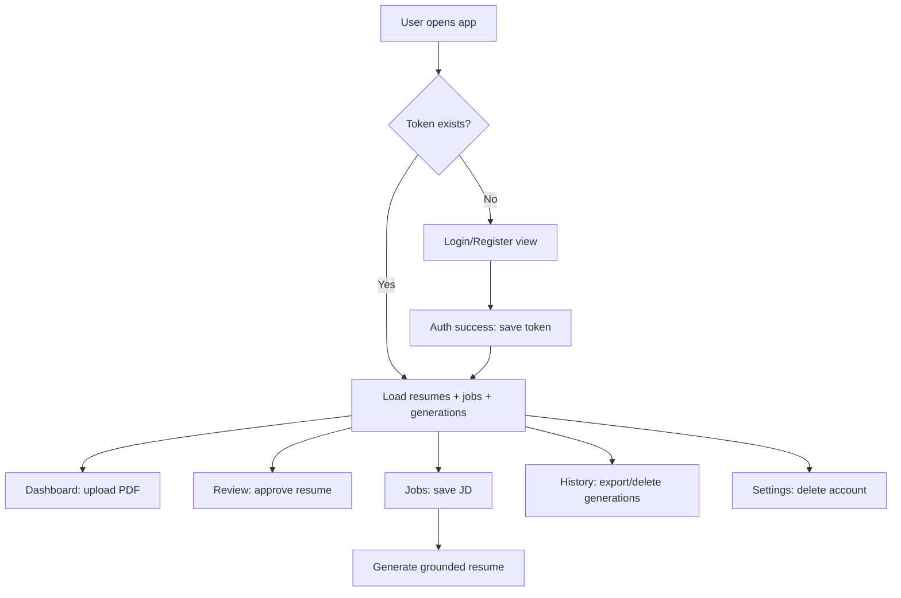

# Resume RAG

Resume RAG is an evidence-first resume tailoring workspace.  
It extracts facts from uploaded resume PDFs, analyzes job descriptions, retrieves supporting evidence from a vector index, and generates tailored resume output without inventing candidate data.

---

## 1) What this project does

### Core idea
- Upload resume PDF.
- Convert PDF text into structured sections.
- Let user review/approve extracted data.
- Index approved resume chunks in Qdrant via embeddings.
- Analyze job description into deterministic signals.
- Retrieve evidence chunks relevant to the job.
- Ask LLM to generate tailored resume JSON constrained to evidence.
- Export final PDF by appending generated content page(s) to original resume PDF.

### Product behavior
- Private, account-scoped workspace per user.
- JWT-based authenticated API for all user data operations.
- Ownership-enforced CRUD for resumes, job descriptions, generations.
- Explicit ingestion and readiness states (`review/approved`, `pending/indexed/failed`).

---

## 2) End-to-end workflow



---

## 3) Architecture overview

## 3.1 Backend architecture



### Layers
- **HTTP/API layer**: routing + request/response handling.
- **Middleware layer**: security, auth, rate limit, file upload, errors.
- **Controller layer**: orchestrates per-endpoint business operations.
- **Service layer**: reusable domain logic (parsing, RAG, generation, export).
- **Persistence layer**: MongoDB documents + Qdrant vector points.

## 3.2 Frontend architecture

- Single-page React app in [main.tsx](C:/Users/royal/OneDrive/Desktop/ResumeRag/frontend/src/main.tsx).
- Hash-based page switching (`dashboard`, `review`, `jobs`, `history`, `settings`).
- One central API helper attaches auth token and handles API errors.
- All workflows are user-driven from a unified workspace UI.

---

## 4) Tech stack (what, where, why)

## Backend
- **Node.js + TypeScript**
  - **Where**: entire [backend/](C:/Users/royal/OneDrive/Desktop/ResumeRag/backend)
  - **Why**: type-safe API and service contracts.
- **Express 5**
  - **Where**: [app.ts](C:/Users/royal/OneDrive/Desktop/ResumeRag/backend/src/app.ts), routes/controllers.
  - **Why**: lightweight REST API composition.
- **Mongoose**
  - **Where**: [models/](C:/Users/royal/OneDrive/Desktop/ResumeRag/backend/src/models), [mongodb.ts](C:/Users/royal/OneDrive/Desktop/ResumeRag/backend/src/config/mongodb.ts)
  - **Why**: schema-based MongoDB persistence with indexes.
- **JWT + bcryptjs**
  - **Where**: [auth.controller.ts](C:/Users/royal/OneDrive/Desktop/ResumeRag/backend/src/controllers/auth.controller.ts), [auth.middleware.ts](C:/Users/royal/OneDrive/Desktop/ResumeRag/backend/src/middleware/auth.middleware.ts)
  - **Why**: secure auth (hashed passwords + stateless access tokens).
- **Multer**
  - **Where**: [upload.middleware.ts](C:/Users/royal/OneDrive/Desktop/ResumeRag/backend/src/middleware/upload.middleware.ts)
  - **Why**: validated PDF upload with file size/type constraints.
- **pdfjs-dist**
  - **Where**: [pdf-parser.service.ts](C:/Users/royal/OneDrive/Desktop/ResumeRag/backend/src/services/resume/pdf-parser.service.ts), [resume-pdf.service.ts](C:/Users/royal/OneDrive/Desktop/ResumeRag/backend/src/services/pdf/resume-pdf.service.ts)
  - **Why**: robust PDF text extraction and style inspection.
- **pdf-lib**
  - **Where**: [resume-pdf.service.ts](C:/Users/royal/OneDrive/Desktop/ResumeRag/backend/src/services/pdf/resume-pdf.service.ts)
  - **Why**: PDF editing/export by appending generated content.
- **Qdrant**
  - **Where**: [qdrant.ts](C:/Users/royal/OneDrive/Desktop/ResumeRag/backend/src/config/qdrant.ts), RAG services.
  - **Why**: efficient semantic retrieval over resume chunks.
- **OpenAI-compatible / Gemini provider support**
  - **Where**: [embedding.service.ts](C:/Users/royal/OneDrive/Desktop/ResumeRag/backend/src/services/rag/embedding.service.ts), [llm.service.ts](C:/Users/royal/OneDrive/Desktop/ResumeRag/backend/src/services/generation/llm.service.ts)
  - **Why**: provider flexibility with consistent internal interface.
- **Zod**
  - **Where**: env validation in [env.ts](C:/Users/royal/OneDrive/Desktop/ResumeRag/backend/src/config/env.ts), generation output schema in [resume-generator.service.ts](C:/Users/royal/OneDrive/Desktop/ResumeRag/backend/src/services/generation/resume-generator.service.ts)
  - **Why**: runtime schema guarantees.
- **Helmet + CORS + express-rate-limit**
  - **Where**: [app.ts](C:/Users/royal/OneDrive/Desktop/ResumeRag/backend/src/app.ts)
  - **Why**: baseline API hardening.

## Frontend
- **React 19 + TypeScript**
  - **Where**: [frontend/src/](C:/Users/royal/OneDrive/Desktop/ResumeRag/frontend/src)
  - **Why**: fast UI iteration with typed state/events.
- **Vite**
  - **Where**: [vite.config.ts](C:/Users/royal/OneDrive/Desktop/ResumeRag/frontend/vite.config.ts)
  - **Why**: quick dev server and production build pipeline.
- **CSS (single stylesheet)**
  - **Where**: [styles.css](C:/Users/royal/OneDrive/Desktop/ResumeRag/frontend/src/styles.css)
  - **Why**: simple, centralized styling for this UI scope.

---

## 5) Backend request lifecycle

1. Request enters [app.ts](C:/Users/royal/OneDrive/Desktop/ResumeRag/backend/src/app.ts).
2. Security middleware applies:
   - `helmet`
   - CORS allowlist
   - JSON body limit
   - global rate limit
3. Route dispatches to controller.
4. `requireAuth` validates JWT when endpoint is protected.
5. Controller checks DB availability and ownership constraints.
6. Controller calls service(s) for domain logic.
7. Response serialized to JSON (or binary PDF for export).
8. Failures go through [error.middleware.ts](C:/Users/royal/OneDrive/Desktop/ResumeRag/backend/src/middleware/error.middleware.ts).

---

## 6) Detailed backend workflows

## 6.1 Authentication workflow
- Routes: `/api/auth/register`, `/api/auth/login` via [auth.routes.ts](C:/Users/royal/OneDrive/Desktop/ResumeRag/backend/src/routes/auth.routes.ts)
- Controller: [auth.controller.ts](C:/Users/royal/OneDrive/Desktop/ResumeRag/backend/src/controllers/auth.controller.ts)
- Steps:
  1. Validate email format + password requirements.
  2. Hash password with bcrypt.
  3. Save/fetch user in MongoDB.
  4. Issue 1-hour JWT (`sub = userId`).

## 6.2 Resume ingestion workflow



Key files:
- Upload middleware: [upload.middleware.ts](C:/Users/royal/OneDrive/Desktop/ResumeRag/backend/src/middleware/upload.middleware.ts)
- Controller: [resume.controller.ts](C:/Users/royal/OneDrive/Desktop/ResumeRag/backend/src/controllers/resume.controller.ts)
- Parsing:
  - [pdf-parser.service.ts](C:/Users/royal/OneDrive/Desktop/ResumeRag/backend/src/services/resume/pdf-parser.service.ts)
  - [text-normalizer.service.ts](C:/Users/royal/OneDrive/Desktop/ResumeRag/backend/src/services/resume/text-normalizer.service.ts)
  - [section-detector.service.ts](C:/Users/royal/OneDrive/Desktop/ResumeRag/backend/src/services/resume/section-detector.service.ts)
  - [resume-parser.service.ts](C:/Users/royal/OneDrive/Desktop/ResumeRag/backend/src/services/resume/resume-parser.service.ts)
- Vector indexing:
  - [chunking.service.ts](C:/Users/royal/OneDrive/Desktop/ResumeRag/backend/src/services/resume/chunking.service.ts)
  - [ingestion.service.ts](C:/Users/royal/OneDrive/Desktop/ResumeRag/backend/src/services/rag/ingestion.service.ts)
  - [embedding.service.ts](C:/Users/royal/OneDrive/Desktop/ResumeRag/backend/src/services/rag/embedding.service.ts)
  - [qdrant.ts](C:/Users/royal/OneDrive/Desktop/ResumeRag/backend/src/config/qdrant.ts)

## 6.3 Job description analysis workflow
- Route: `POST /api/job-descriptions`
- Controller: [jd.controller.ts](C:/Users/royal/OneDrive/Desktop/ResumeRag/backend/src/controllers/jd.controller.ts)
- Analysis service: [jd-analyzer.service.ts](C:/Users/royal/OneDrive/Desktop/ResumeRag/backend/src/services/jd/jd-analyzer.service.ts)
- Behavior:
  - deterministic extraction of `skills`, `qualifications`, `responsibilities`, `keywords`
  - no LLM dependency for this stage

## 6.4 RAG generation workflow



Key files:
- Controller: [generation.controller.ts](C:/Users/royal/OneDrive/Desktop/ResumeRag/backend/src/controllers/generation.controller.ts)
- Retrieval: [retrieval.service.ts](C:/Users/royal/OneDrive/Desktop/ResumeRag/backend/src/services/rag/retrieval.service.ts)
- LLM adapter: [llm.service.ts](C:/Users/royal/OneDrive/Desktop/ResumeRag/backend/src/services/generation/llm.service.ts)
- Output schema guard: [resume-generator.service.ts](C:/Users/royal/OneDrive/Desktop/ResumeRag/backend/src/services/generation/resume-generator.service.ts)

## 6.5 PDF export workflow
- Route: `GET /api/generations/:id/export`
- Controller resolves:
  - generation record
  - source resume file
  - related job analysis keywords
- Service [resume-pdf.service.ts](C:/Users/royal/OneDrive/Desktop/ResumeRag/backend/src/services/pdf/resume-pdf.service.ts):
  - loads original PDF
  - inspects first page style (margins/font sizing)
  - appends a tailored content page preserving style characteristics
  - returns binary PDF buffer

## 6.6 Account deletion workflow
- Route: `DELETE /api/account`
- Controller: [account.controller.ts](C:/Users/royal/OneDrive/Desktop/ResumeRag/backend/src/controllers/account.controller.ts)
- Deletes:
  - user account
  - resumes/jobs/generations
  - uploaded files from disk
  - user vectors from Qdrant (best-effort; status returned)

---

## 7) Frontend workflow



Frontend implementation summary:
- API base URL from `VITE_API_URL`, with localhost/deployed fallback.
- JWT persisted in `localStorage`.
- Unified request helper handles auth headers and API error message parsing.
- Uses optimistic loading state (`busy`) and confirmation guard (`pendingConfirmation`) for destructive actions.

Key files:
- App logic: [main.tsx](C:/Users/royal/OneDrive/Desktop/ResumeRag/frontend/src/main.tsx)
- Styling: [styles.css](C:/Users/royal/OneDrive/Desktop/ResumeRag/frontend/src/styles.css)
- Entry HTML: [index.html](C:/Users/royal/OneDrive/Desktop/ResumeRag/frontend/index.html)

---

## 8) API surface (high-level)

## Public
- `GET /health` - process health
- `GET /ready` - Mongo readiness
- `POST /api/auth/register`
- `POST /api/auth/login`

## Auth required
- `POST /api/resumes/upload`
- `GET /api/resumes`
- `GET /api/resumes/:id`
- `PATCH /api/resumes/:id`
- `DELETE /api/resumes/:id`
- `POST /api/job-descriptions`
- `GET /api/job-descriptions`
- `GET /api/job-descriptions/:id/match`
- `DELETE /api/job-descriptions/:id`
- `POST /api/generations`
- `GET /api/generations`
- `DELETE /api/generations/:id`
- `GET /api/generations/:id/export`
- `DELETE /api/account`

---

## 9) Data models

Defined under [backend/src/models/](C:/Users/royal/OneDrive/Desktop/ResumeRag/backend/src/models):

- **User**
  - `email`, `passwordHash`, timestamps
- **Resume**
  - `userId`, file metadata, extracted `text`, `structuredResume`
  - `status`: `review | approved`
  - `ingestionStatus`: `pending | indexed | failed`
- **JobDescription**
  - `userId`, `title`, `text`, deterministic `analysis`
- **Generation**
  - `userId`, `resumeId`, `jobDescriptionId`
  - `output` (LLM JSON), `evidence` (retrieved chunks)

---

## 10) Environment variables

Reference source: [backend/.env.example](C:/Users/royal/OneDrive/Desktop/ResumeRag/backend/.env.example)

## Core runtime
- `NODE_ENV`, `PORT`
- `FRONTEND_ORIGIN`
- `JWT_SECRET`
- `UPLOAD_DIR`, `MAX_UPLOAD_BYTES`

## MongoDB
- `MONGODB_URI`
- `MONGODB_USERNAME`, `MONGODB_PASSWORD` (optional credential injection)
- `MONGODB_DNS_SERVERS` (optional DNS override)

## Qdrant / embeddings
- `QDRANT_URL`, `QDRANT_API_KEY`, `QDRANT_COLLECTION`
- `EMBEDDING_PROVIDER` (`openai-compatible | gemini`)
- `EMBEDDING_API_URL`, `EMBEDDING_API_KEY`, `EMBEDDING_MODEL`, `EMBEDDING_DIMENSIONS`
- `GEMINI_EMBEDDING_MODEL`

## LLM generation
- `LLM_PROVIDER` (`openai-compatible | gemini`)
- `LLM_API_URL`, `LLM_API_KEY`, `LLM_MODEL`
- `GEMINI_API_KEY`, `GEMINI_MODEL`
- `AI_REQUEST_TIMEOUT_MS`

---

## 11) Local development setup

1. Start dependencies:
   - MongoDB
   - Qdrant (if testing ingestion/retrieval)
2. Configure backend:
   - copy [backend/.env.example](C:/Users/royal/OneDrive/Desktop/ResumeRag/backend/.env.example) to `.env`
   - set `JWT_SECRET` (>= 32 chars)
   - configure AI provider keys if testing generation
3. Run backend:

   ```powershell
   cd backend
   npm install
   npm run build
   npm start
   ```

4. Run frontend:

   ```powershell
   cd frontend
   npm install
   npm run dev
   ```

5. Open `http://localhost:5173`.

---

## 12) Overleaf LaTeX generation

Generation history supports creating both a tailored `.tex` file and a compiled
PDF from an Overleaf `main.tex` template. Paste the template into the LaTeX
field and add these markers around the summary content:

```tex
% RESUMERAG:SUMMARY:START
Your original summary
% RESUMERAG:SUMMARY:END
```

Only the content between these markers is replaced. The remaining LaTeX source,
including packages, fonts, spacing, section order, and custom commands, is
preserved exactly. The generated summary is escaped before insertion.

The backend compiles a single `main.tex` source with `-no-shell-escape` in a temporary directory,
with a timeout and automatic cleanup. Install a LaTeX distribution that
provides `pdflatex`, or set `LATEX_COMPILER` to an approved compiler executable.
The compiler is intentionally not bundled with the Node application.

## 13) Build, test, and scripts

## Backend scripts ([backend/package.json](C:/Users/royal/OneDrive/Desktop/ResumeRag/backend/package.json))
- `npm run dev` - hot-reload TypeScript server
- `npm run build` - compile TypeScript
- `npm start` - run compiled server
- `npm test` - build + node test runner

## Frontend scripts ([frontend/package.json](C:/Users/royal/OneDrive/Desktop/ResumeRag/frontend/package.json))
- `npm run dev` - Vite dev server
- `npm run build` - TS build + production bundle

Current automated tests:
- [resume-parser.test.mjs](C:/Users/royal/OneDrive/Desktop/ResumeRag/backend/test/resume-parser.test.mjs)
  - parser behavior
  - JD analyzer deterministic extraction

---

## 13) Deployment notes

## Backend (Render)
- Root dir: `backend`
- Build: `npm install && npm run build`
- Start: `npm start`
- `postinstall` runs `npm run build` to ensure `dist/server.js` exists.

## Frontend (Netlify or similar)
- set `VITE_API_URL` to deployed backend `/api` base.

---

## 14) Important design decisions

- **Evidence-first generation**: generation is blocked unless approved resume has retrievable indexed evidence.
- **Structured extraction before AI generation**: parsing and JD analysis are deterministic and auditable.
- **Provider abstraction**: both embedding and LLM logic support OpenAI-compatible and Gemini paths.
- **Validation at boundaries**:
  - env validation with Zod
  - generation output schema validation with Zod
  - strict request/file checks in controllers + multer
- **Ownership isolation**: every DB query is scoped to authenticated `userId`.

---

## 15) Known implementation notes

- [reranking.service.ts](C:/Users/royal/OneDrive/Desktop/ResumeRag/backend/src/services/rag/reranking.service.ts) and [resume.service.ts](C:/Users/royal/OneDrive/Desktop/ResumeRag/backend/src/services/resume/resume.service.ts) currently exist as placeholders and are not part of the active request path.
- Resume ingestion to vectors is intentionally deferred until explicit approval.
- If embedding/LLM providers are not configured, related operations fail with explicit messages while core CRUD remains available.
